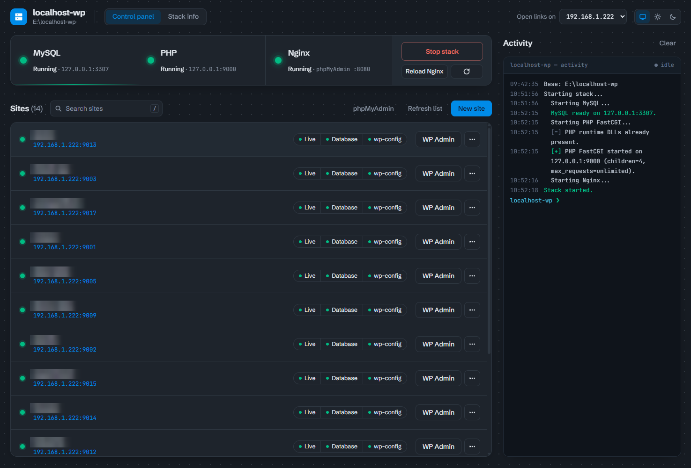
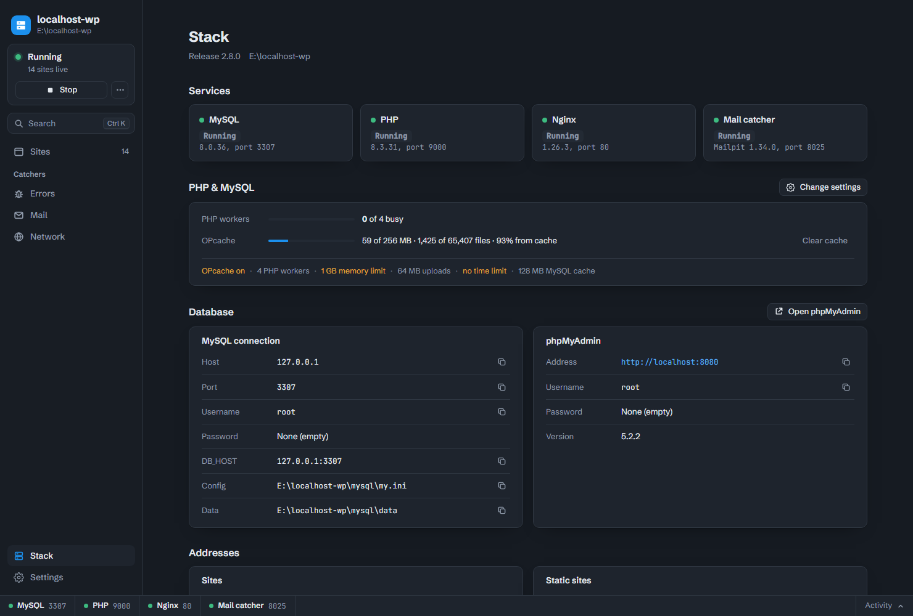
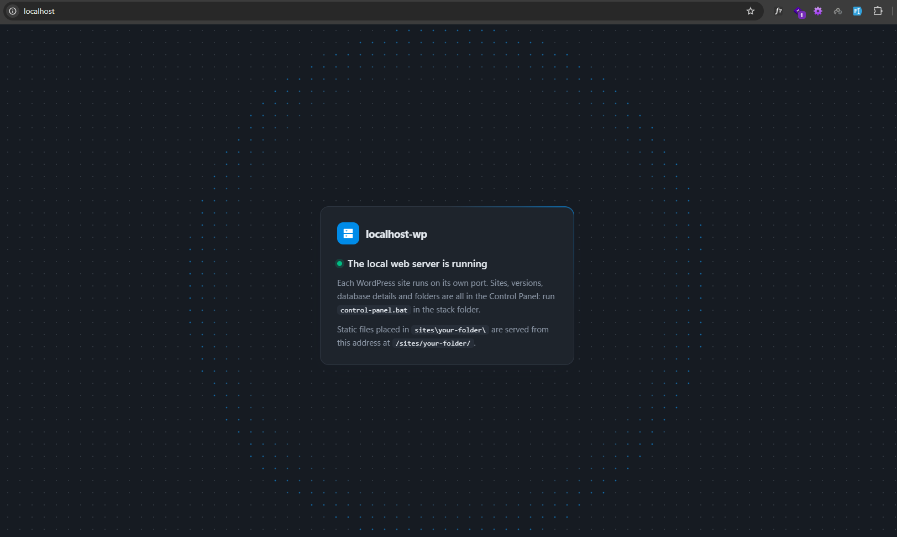

# localhost-wp

Release: `v2.7.1`

A self-contained local WordPress development stack for Windows — Nginx · MySQL 8.0 · PHP 8.5.12 · phpMyAdmin — managed through a GUI control panel.

---

## Requirements

- **Windows 10 or later**
- **PowerShell** (built into Windows, no extra install needed)

---

## Getting Started

### 1. Clone the repository

```
git clone <repo-url> localhost-wp
```

### 2. Launch the control panel

Double-click **`control-panel.bat`** in the project root.

**First run (no binaries yet):**
The control panel detects that the stack has not been set up and shows a **Run setup** button. Click it, pick the PHP version (any Windows build from 8.3.0 up, 8.3.31 preselected), and setup downloads and configures everything, with progress in the activity log.

**Every run after that:**
The control panel opens directly into the normal interface. No setup prompt.

### Control Panel window (Electron, portable)

The Control Panel opens in its own window with a tray icon, run by a portable Electron in `electron\` (nothing is installed). The first `control-panel.bat` run downloads it (setup does too); if that fails the bat falls back to an Edge app window.

After that you don't need the bat. Any of these opens the Control Panel directly:

- `localhost-wp.lnk`, the shortcut in the stack folder (with the app icon)
- `electron\localhost-wp.exe` (Electron, renamed; its `resources\app` loads `dashboard\electron\main.js`)
- a taskbar pin: right-click the open window's taskbar button, **Pin to taskbar**. Each stack pins separately, named after its folder.

The shortcut holds absolute paths. After moving a stack folder, run `get-electron.ps1` (below) to recreate it, and re-pin.

- Closing the window hides it to the tray. The tray menu starts or stops the stack (the Stop items show only while something runs), opens phpMyAdmin and the mail inbox while the stack is up, and **Quit** leaves the stack running.
- Each stack folder is its own app: its Electron profile lives in `electron\userdata`, so two stacks (say `F:\localhost-wp-8.5` and `E:\localhost-wp`) never share a window. Launching the same stack again brings its window back.
- The window title shows the stack folder.
- The tray icon shows the stack state with a dot: green when everything runs, amber while busy or partly up, no dot when stopped.
- Long jobs (setup, new site) fill the taskbar button with their progress. When a job ends while the window is hidden or in the background, a notification says how it went; clicking it opens the window.
- When Windows shuts down, restarts or signs out with the stack running, the app stops it gracefully first (no backup) so MySQL closes its files cleanly. What happened is written to `logs\shutdown.log`.
- Each site's **⋯** menu has **Open in VS Code** (opens `sites\<name>\public`) when VS Code is installed.
- Notifications are Windows toasts. Windows shows a desktop app's toasts only when a Start Menu shortcut carries the app's ID, so the app keeps one named after the stack folder (for example `localhost-wp - E localhost-wp`); it also starts the app from Start. If a toast cannot be shown, a tray balloon is used instead.
- The app checks GitHub for a newer release every few hours. A new version gets one notification, and the tray menu links to its release page until you update.

To add Electron to a stack that is already set up:

```
powershell -ExecutionPolicy Bypass -File scripts\helper\get-electron.ps1
```

The download is checked against the release's SHA-256 list. Change `electron.version` in `versions.json` and run it again to upgrade.

### Several stacks on one PC

Stacks share the same ports (80, 1025, 3307, 8025, 8080, 9000, 9001+), so one runs at a time.

- Each dashboard takes its own port: `7070`, or the next free one if another stack's dashboard is open.
- Services count as this stack's only when their `.exe` lives in this folder. Another stack's MySQL or Nginx is never shown as running here, and **Stop** never touches it.
- While another stack is running, the dashboard names its folder and **Start** refuses until it is stopped from its own Control Panel.

### Mail catcher

Every email your sites send (password resets, contact forms, WooCommerce orders) lands in a local inbox instead of going out, so nothing reaches real people while you test, even on a copy of a live site.

- It is [Mailpit](https://mailpit.axllent.org), one portable `mailpit.exe` in `mailpit\`. Setup downloads it; on an older stack the next **Start stack** does. Its version is `mailpit.version` in `versions.json`.
- It starts and stops with the stack: mail in on `127.0.0.1:1025`, inbox at **http://localhost:8025**.
- Open it with the **Mail** button next to phpMyAdmin (it shows how many are unread) or **Mail inbox** in the tray. **Stack info** lists its address and version.
- Each new email pops up a Windows notification with its sender and subject (or "3 new emails" when several arrive together); clicking it opens the inbox. Mail already there when the app starts does not pop up.
- No plugin and no change to the sites: `php.ini` sends PHP's mail to the catcher (`SMTP = 127.0.0.1`, `smtp_port = 1025`).
- `scripts\php\mail-catcher.php`, loaded before every request (see [What runs before every request](#what-runs-before-every-request)), makes sure nothing slips out:
  - **SMTP plugins** set to send through Gmail, SendGrid, Brevo and the like are switched to PHP mail with their own constants: `WPMS_ON` / `WPMS_MAILER` (WP Mail SMTP) and `EASY_WP_SMTP_ON` / `EASY_WP_SMTP_MAILER` (Easy WP SMTP). Their settings pages show the mailer as set by a constant; nothing is saved to the database, so the site's real settings stay as they are.
  - Any other plugin that switches WordPress's mailer to SMTP is switched back to PHP mail just before sending.
  - WordPress sends from `wordpress@<site host>`, and for a site on `localhost` it rejects that address itself (no dot). It becomes `wordpress@localhost.test` in that one case; a From address a site or plugin sets is kept.
- Not covered: plugins that replace WordPress's mail function and call a web API themselves (Post SMTP, FluentSMTP with an API mailer). Deactivate those on local copies, or set their mailer to PHP / Default.
- Caught mail is kept in `mailpit\mailpit.db` between restarts; delete it from the inbox page.

**Turning it off.** The **Mail catcher** panel on **Stack info** has a **Turn off / Turn on** button, and the tray menu has a **Mail catcher** checkbox; both ask first. Off means the stack leaves mail completely alone:

- Mailpit does not run (and is not downloaded on a stack that never had it).
- `php.ini` gets PHP's defaults back (`SMTP = localhost`, `smtp_port = 25`) and `mail-catcher.php` is no longer loaded, so SMTP plugins send with their own settings again, to real addresses.
- Mail already in the inbox is kept for when it is turned back on.

PHP reads `php.ini` only when it starts, so switching while the stack runs restarts PHP for about a second; MySQL and Nginx keep running. With the stack stopped, the choice applies at the next start. It is remembered per stack in `config\mail-catcher.txt` (on unless that file says `off`).

### Error catcher

Every PHP error your sites report is collected in one place: **Errors** in the sidebar, and an **Errors** tab on each site's page.

- Errors are grouped: the same message from the same file and line is one row, with how many times it happened, in how many requests, and when it was first and last seen. Fatal errors (including uncaught exceptions, with their stack trace) are marked red, warnings amber.
- Click a row for the details: the stack trace, the request that caused it (click to open it again), and **Open in VS Code**, which opens the file at that line. Without VS Code, **Show the file** selects it in Explorer.
- Filter by Fatal, Warnings, Notices or Deprecated, and by site. **Mark all as read** and **Clear** work for the list you are looking at.
- New fatal errors show as a red count on **Errors** in the sidebar and as "1 fatal" on the site's row in **Sites**. Each site's **Overview** has an **Errors** card with its counts and latest errors; its **Debugging** card keeps the raw `debug.log` and Nginx error log under **Log files**.
- **Alerts** pop up the moment an error is caught: the app watches `logs\errors` and reads only what was added. **Settings > Notifications** picks the level: Off, Fatal only (the default), Fatal and warnings, or Everything. A fatal error stays on screen until you close it, with a sound; a warning shows briefly; notices and deprecations are silent. The same error alerts at most once in 10 minutes, errors arriving together make one alert, and nothing pops up while that error list is on screen. Clicking an alert opens the error. A site's **Errors** tab can mute its alerts (its errors are still caught), kept in `config\error-alerts-muted.json`.
- It only watches. PHP's own handling goes on unchanged, so `debug.log`, errors shown on the page and WordPress's "critical error" page behave exactly as before. It records what PHP reports: with **Debug mode** off WordPress leaves out notices and deprecations, and anything silenced with `@` is not recorded.
- Stored per site in `logs\errors\<site>.jsonl` (moved to `<site>.old.jsonl` at 4 MB). The **Errors** page has an on/off switch; it applies to the next request, no restart. It is remembered in `config\error-catcher.txt` (on unless that file says `off`).

### Network catcher

Every call your sites make to the internet through WordPress (update checks, licence checks, APIs, remote fonts) is recorded: **Network** in the sidebar, and a **Network** tab on each site's page.

- **Calls** lists each one: status (or Failed / Timeout / Blocked), method, host and path, how long it took (amber from 2 s), size, and the plugin or theme that made it. Click a call for the full address, the result, the page it happened on, and **Block** for its host. Filter by Slow, Failed or Blocked, and by site; local calls (WP-Cron, the site calling itself) are hidden unless you show them.
- **Hosts** has one row per host: calls, average and slowest time, failures, which sites and plugins use it, and **Block / Unblock**.
- **Blocking** has three modes. **Log only** (the default) blocks nothing except hosts you block yourself. **Block slow hosts** blocks a host for an hour once a call to it takes 5 s or more or times out. **Block all external** works as if this PC were offline. A blocked call fails at once with a WordPress error, so the page no longer waits on it. Calls to this PC, private addresses and the site itself are never blocked.
- Sites with slow or failed calls in the last hour show "2 slow" in **Sites**, and the count shows on **Network** in the sidebar.
- Values in addresses that look like secrets (`key=`, `token=`, `license=`, ...) are masked before anything is written.
- It sees calls made through WordPress's HTTP API (`wp_remote_get`, `wp_remote_post`, ...), which is what core, plugins and themes use. Code that calls cURL or `file_get_contents` directly is not seen.
- Stored per site in `logs\network\<site>.jsonl` (moved to `<site>.old.jsonl` at 4 MB). The blocking rules are in `config\network-rules.json`. The **Network** page has an on/off switch, remembered in `config\network-catcher.txt`.

### What runs before every request

`php.ini`'s `auto_prepend_file` loads `scripts\php\localhost-wp.php` before every PHP request. It loads `error-catcher.php`, `mail-catcher.php` and `network-catcher.php`, each unless its `config\<name>.txt` says `off`. Those files are read on every request, so switching a catcher on or off needs no PHP restart. **Start stack** points `php.ini` at it (`scripts\helper\ensure-mail.ps1`), and leaves an `auto_prepend_file` of your own alone.

---

## What Setup Does

Setup runs once and handles everything automatically:

- Downloads and installs Nginx, MySQL, PHP (NTS, the version you picked), phpMyAdmin and the Mailpit mail catcher
- Configures `php.ini` (extensions, upload limits, mail to the catcher)
- Configures MySQL (`my.ini`, initializes data directory)
- Writes Nginx configs (main, phpMyAdmin vhost, WordPress snippet)
- Configures phpMyAdmin

If the binaries already exist, setup skips re-downloading them. To install a different PHP version later, delete `php\` and run setup again.

### Versions

All versions and download addresses live in **`versions.json`** at the project root; the scripts hold none.

| Key | Meaning |
|-----|---------|
| `php.default` | PHP version preselected in the setup dialog (`8.3.31`) |
| `php.min` | Oldest PHP the dialog offers and setup accepts (`8.3.0`) |
| `nginx` / `mysql` / `phpmyadmin` | Fixed version plus a download URL template (`{v}` = version, `{mm}` = major.minor) |

PHP builds come from windows.php.net: the newest patch of each branch from `releases/`, older ones from `releases/archives/`.

### Optional: manual pre-download

To avoid download time during setup, extract the packages from the URLs in `versions.json` into `nginx\`, `mysql\`, `php\` and `phpmyadmin\` before running.

---

## Control Panel

All stack and site management is done through the GUI — no terminal needed.

**Stack section**
| Button | What it does |
|--------|-------------|
| Start Stack | Starts MySQL, PHP FastCGI, and Nginx |
| Stop Stack | Backs up all databases, then stops the stack |
| Refresh status | Shows which services are running |

**Sites section**
| Button | What it does |
|--------|-------------|
| + New site | Creates a WordPress site (database + files + Nginx vhost) |
| phpMyAdmin | Opens phpMyAdmin at `http://localhost:8080` |
| Refresh list | Reloads the site list |

Versions, database login, site addresses and folders are on the **Stack info** tab.

Each site card shows its port, server status, database status, wp-config status, and buttons to open the site, WP Admin, back up the database, or delete the site.

The **Open links on** selector at the top right of the Sites section controls whether links use `localhost` or the machine IP (useful for testing from a phone on the same network).

---

## Directory Layout

What is tracked in git:

```
localhost-wp/
├─ dashboard/
│  ├─ index.html              Control Panel UI
│  ├─ electron/               Electron shell: main.js (window, tray, taskbar pin)
│  └─ server/
│     ├─ server.ps1           Local web server + JSON API on http://localhost:7070
│     ├─ bridge.ps1           Loads cp-*.ps1 without the WinForms GUI
│     └─ worker.ps1           Runs long stack/site operations in the background
├─ scripts/
│  ├─ control-panel.ps1       Old WinForms GUI (no longer launched)
│  ├─ cp-core.ps1             Utilities, status checks, helpers
│  ├─ cp-stack.ps1            Start/Stop/Reload stack logic
│  ├─ cp-sites.ps1            New site, backup, delete logic
│  ├─ php/
│  │  ├─ localhost-wp.php     Loaded before every request; loads the catchers that are on
│  │  ├─ error-catcher.php    Records PHP errors per site for the Errors page
│  │  ├─ network-catcher.php  Records (and can block) the calls sites make to the internet
│  │  └─ mail-catcher.php     Keeps WordPress mail in the catcher (SMTP plugins, From address)
│  └─ helper/
│     ├─ setup.ps1            First-time setup (downloads + configures)
│     ├─ download.ps1         Download/extract helpers shared by setup
│     ├─ get-electron.ps1     Portable Electron into electron\ (checksum verified)
│     ├─ ensure-mail.ps1      Mailpit into mailpit\, php.ini's mail lines and auto_prepend_file
│     ├─ versions.ps1         Reads versions.json, finds PHP builds
│     ├─ ensure-php-runtime.ps1
│     ├─ start-php.ps1
│     ├─ backup-databases.ps1
│     └─ create-nginx-conf.ps1
├─ control-panel.bat          Entry point — launch this
├─ index.html                 Short "server is running" page at http://localhost
├─ versions.json              Binary versions and download URLs
├─ .gitignore
├─ README.md
└─ VERSION
```

Created by setup (gitignored — not committed):

```
nginx/       mysql/       php/       phpmyadmin/       electron/
mailpit/     config/      logs/        sites/
```

---

## Sites and ports

Sites are served over plain HTTP on the next free port from `9001` up (`9000` is PHP FastCGI). Any port already used by a vhost in `config/nginx/`, or currently listening, is skipped; the last assigned port is kept in `config/ports.txt`.

---

## Backups

Database backups run automatically every time the stack is stopped via the GUI. They are also available on demand per site via the **Backup DB** button on each site card.

Backups are stored in `sites/<site-name>/sql/` with a rolling two-file rotation:

```
sites/mysite/sql/
├─ backup-2026-06-15-10-30.sql   ← latest
└─ backup-2026-06-14-22-00.sql   ← previous
```

---

## Glimpse

  
  
  

