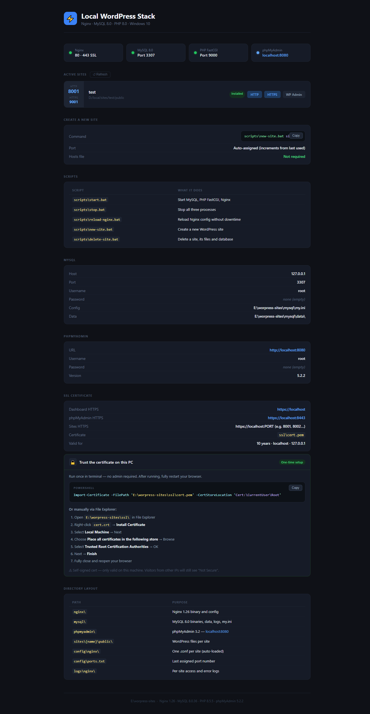

# localhost-wp

Release: `v2.2.0`

A self-contained local WordPress development stack for Windows — Nginx · MySQL 8.0 · PHP 8.5.12 · phpMyAdmin — managed through a GUI control panel.

---

## Requirements

- **Windows 10 or later**
- **PowerShell** (built into Windows, no extra install needed)

---

## Getting Started

### 1. Clone the repository

```
git clone <repo-url> localhost-wp
```

### 2. Launch the control panel

Double-click **`control-panel.bat`** in the project root.

**First run (no binaries yet):**
The control panel detects that the stack has not been set up and shows a **Run setup** button. Click it, pick the PHP version (any Windows build from 8.3.0 up, 8.3.31 preselected), and setup downloads and configures everything, with progress in the activity log.

**Every run after that:**
The control panel opens directly into the normal interface. No setup prompt.

---

## What Setup Does

Setup runs once and handles everything automatically:

- Downloads and installs Nginx, MySQL, PHP (NTS, the version you picked) and phpMyAdmin
- Configures `php.ini` (extensions, upload limits)
- Configures MySQL (`my.ini`, initializes data directory)
- Writes Nginx configs (main, phpMyAdmin vhost, WordPress snippet)
- Configures phpMyAdmin

If the binaries already exist, setup skips re-downloading them. To install a different PHP version later, delete `php\` and run setup again.

### Versions

All versions and download addresses live in **`versions.json`** at the project root; the scripts hold none.

| Key | Meaning |
|-----|---------|
| `php.default` | PHP version preselected in the setup dialog (`8.3.31`) |
| `php.min` | Oldest PHP the dialog offers and setup accepts (`8.3.0`) |
| `nginx` / `mysql` / `phpmyadmin` | Fixed version plus a download URL template (`{v}` = version, `{mm}` = major.minor) |

PHP builds come from windows.php.net: the newest patch of each branch from `releases/`, older ones from `releases/archives/`.

### Optional: manual pre-download

To avoid download time during setup, extract the packages from the URLs in `versions.json` into `nginx\`, `mysql\`, `php\` and `phpmyadmin\` before running.

---

## Control Panel

All stack and site management is done through the GUI — no terminal needed.

**Stack section**
| Button | What it does |
|--------|-------------|
| Start Stack | Starts MySQL, PHP FastCGI, and Nginx |
| Stop Stack | Backs up all databases, then stops the stack |
| Refresh status | Shows which services are running |

**Sites section**
| Button | What it does |
|--------|-------------|
| + New site | Creates a WordPress site (database + files + Nginx vhost) |
| phpMyAdmin | Opens phpMyAdmin at `http://localhost:8080` |
| Refresh list | Reloads the site list |

Versions, database login, site addresses and folders are on the **Stack info** tab.

Each site card shows its port, server status, database status, wp-config status, and buttons to open the site, WP Admin, back up the database, or delete the site.

The **Open links on** selector at the top right of the Sites section controls whether links use `localhost` or the machine IP (useful for testing from a phone on the same network).

---

## Directory Layout

What is tracked in git:

```
localhost-wp/
├─ dashboard/
│  ├─ index.html              Control Panel UI (opens in an Edge app window)
│  └─ server/
│     ├─ server.ps1           Local web server + JSON API on http://localhost:7070
│     ├─ bridge.ps1           Loads cp-*.ps1 without the WinForms GUI
│     └─ worker.ps1           Runs long stack/site operations in the background
├─ scripts/
│  ├─ control-panel.ps1       Old WinForms GUI (no longer launched)
│  ├─ cp-core.ps1             Utilities, status checks, helpers
│  ├─ cp-stack.ps1            Start/Stop/Reload stack logic
│  ├─ cp-sites.ps1            New site, backup, delete logic
│  └─ helper/
│     ├─ setup.ps1            First-time setup (downloads + configures)
│     ├─ versions.ps1         Reads versions.json, finds PHP builds
│     ├─ ensure-php-runtime.ps1
│     ├─ start-php.ps1
│     ├─ backup-databases.ps1
│     └─ create-nginx-conf.ps1
├─ control-panel.bat          Entry point — launch this
├─ index.html                 Short "server is running" page at http://localhost
├─ versions.json              Binary versions and download URLs
├─ .gitignore
├─ README.md
└─ VERSION
```

Created by setup (gitignored — not committed):

```
nginx/       mysql/       php/       phpmyadmin/
config/      logs/        sites/
```

---

## Sites and ports

Sites are served over plain HTTP on the next free port from `9001` up (`9000` is PHP FastCGI). Any port already used by a vhost in `config/nginx/`, or currently listening, is skipped; the last assigned port is kept in `config/ports.txt`.

---

## Backups

Database backups run automatically every time the stack is stopped via the GUI. They are also available on demand per site via the **Backup DB** button on each site card.

Backups are stored in `sites/<site-name>/sql/` with a rolling two-file rotation:

```
sites/mysite/sql/
├─ backup-2026-06-15-10-30.sql   ← latest
└─ backup-2026-06-14-22-00.sql   ← previous
```

---

## Dashboard


